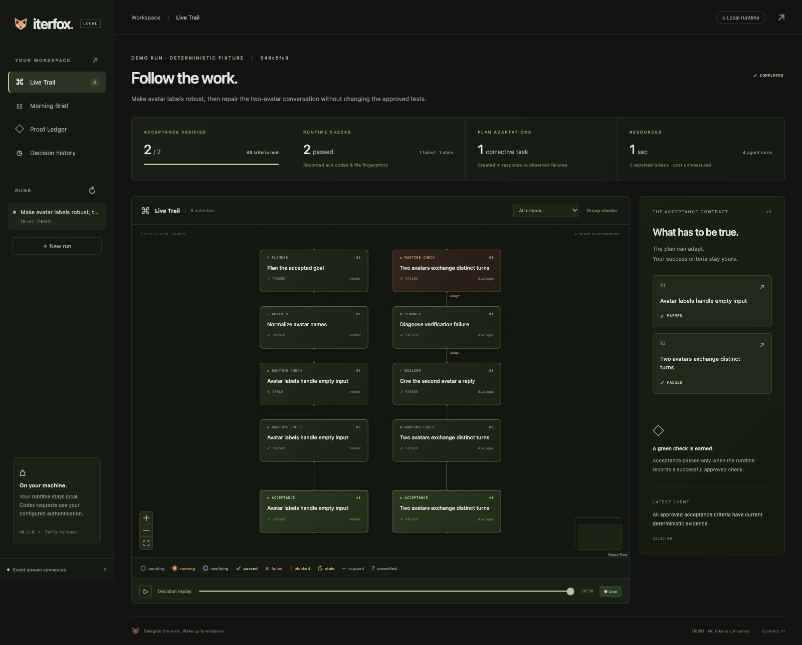
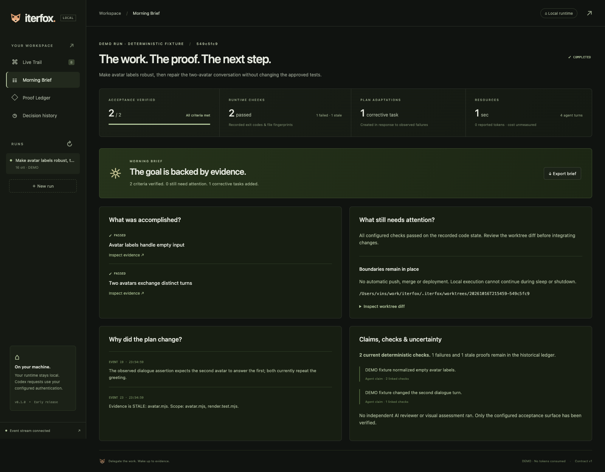

# Iterfox

**Delegate the work. Wake up to evidence.**

[Guida pratica in italiano: come avviare e governare il lavoro](README.it.md)

Iterfox develops toward a project goal while you are away. Give it direction and
checks you trust. In project mode it implements, verifies a milestone, inspects the
actual result and discovers the next useful work without another prompt. Reversible
choices stay with the agent. Return to inspect the result, evidence and decisions.

This is an early working MVP. Only Codex is supported. It does not automatically
push, merge or deploy. A completed agent turn is not a passing acceptance check.

## Who governs the process?

**You approve the destination and boundaries. Iterfox chooses and adapts the work
inside them. You review the result before integrating it.**

| Decision                                                                     | Who controls it?                                                                                                    |
| ---------------------------------------------------------------------------- | ------------------------------------------------------------------------------------------------------------------- |
| Goal, success criteria, exact check commands, editable paths and work window | You review the draft and explicitly authorize them before launch.                                                   |
| Implementation order, corrections and further work toward the same goal      | Iterfox plans and adapts these during the run. Enable project development to discover work after green checks.      |
| Reversible implementation and design choices                                 | Delegated to the agent unless you explicitly reserve a decision in the handoff.                                     |
| New priorities and context during work                                       | You add requests, decisions or hypotheses in Project Compass. They apply after the current activity.                |
| Changing approved success criteria or limits                                 | You pause and explicitly approve a versioned contract revision through the CLI. A Compass note cannot authorize it. |
| Integrating, publishing or deploying the result                              | You do this after reviewing the isolated worktree and evidence.                                                     |

A **run** is one authorized session. Its **contract** stores the approved goal,
checks, edit boundaries and limits. Its **handoff** is optional additional context:
priorities, settled choices, hypotheses and decisions reserved for you. The handoff
can evolve while the contract remains in force.

For your first real session:

1. Open **New run → From a goal**, choose a committed Git repository and describe
   what should work when you return.
2. Keep **Develop the project autonomously** selected. In the optional handoff,
   explain priorities and which decisions require you.
3. Generate the Codex draft. Review the goal, checks, paths and work window. An
   existing regression command may protect old behavior without checking the new
   feature: make sure the proposed criteria actually cover your desired result.
4. Choose **Review preflight**, inspect the final values, then **Authorize & start
   Night Run**. This starts the worker; drafting alone does not.
5. Leave it running, or open **Project Compass** to steer. **Pause** interrupts the
   current activity; **Resume** continues within the original limits. **Stop** also
   interrupts work and keeps the files/history; it can be explicitly resumed.
6. Return to **Morning Brief**, inspect **Proof Ledger** and review the worktree
   diff. `COMPLETED` means the configured policies are satisfied and, in project
   mode, the supervisor considers the goal ready. Your product review still matters.

When a decision is parked in Compass, independent work can continue. Use **Answer
this question** for a linked reply. If the run has become `BLOCKED`, resolve its
displayed reason and explicitly resume. A note saved on an inactive run does not
restart it. Work stops when the goal is ready, progress needs your intervention or
an approved limit is reached; eight hours is a maximum window, not work to fill.
Paused time counts toward that window. Neither resume nor a new note extends it.

For an example handoff, state meanings and intervention steps, read the
[Italian operating guide](README.it.md). The [English Compass guide](docs/project-compass.md)
covers steering, and the [goal launch guide](docs/goal-launch.md) covers draft review
and recovery. Notes entered in a separate Codex chat are not imported into Iterfox.



_Real UI screenshot of the labeled DEMO fixture: a failed command check caused a
corrective task, invalidated an earlier proof, and triggered a recheck. The screenshot
is not a real-Codex run. Real integration evidence is linked below._

## Quickstart

Requires **Node 22.13+**, npm and Git. macOS is locally validated; a Linux/macOS CI
matrix is included. Native Windows unattended execution has not been validated.
Node 22 may print an experimental warning for its built-in SQLite module.

Install from this source checkout; no npm release is assumed:

```sh
npm ci
npm run build
npm run demo
npm run iterfox -- ui
```

Open **http://127.0.0.1:4310**. The demo makes a fresh small Git repository, runs real
Node tests, fixes two fixture defects with a **DEMO** provider, and consumes no model
tokens. Its provider behavior is intentionally scripted; the production engine is not.
Use the graph, click a node, inspect the Proof Ledger, or replay the recorded failure.

To add the CLI to your local PATH after building:

```sh
npm install --global .
iterfox status
```

You can always use `node /absolute/path/to/Iterfox/dist/cli.js` without a global install.

## Run real Codex

The official SDK includes a Codex CLI. It uses your existing Codex authentication;
you need a Codex account/login or a supported API-key setup and network access to
the Codex service. Iterfox does not store or ask you to paste credentials. Authenticate
with your installed official `codex login` if needed. See the
[official SDK documentation](https://learn.chatgpt.com/docs/codex-sdk).

```sh
# Same fixture, real Codex. Review the printed preflight and type yes.
npm run iterfox -- demo --codex

# A real repository, with explicit authorization of the reviewed configuration.
node /path/to/Iterfox/dist/cli.js run \
  --repo /path/to/my-project \
  --config /path/to/my-project/iterfox.json \
  --data /path/to/my-project/.iterfox \
  --project --night --yes
```

Only committed HEAD is copied into a separate `iterfox/<run-id>` worktree. Your
uncommitted source work stays intact. Prepare any dependencies needed by the checks
in that worktree yourself; the runtime does not install packages or grant network
access to agent commands. Missing dependencies produce failed checks or a blocker.

`ITERFOX_MODEL` optionally selects a model available to your account.
`ITERFOX_CODEX_PATH` optionally selects an absolute path to a compatible official CLI.
The runtime disables external integrations and verifies MCP restrictions before each
turn. Unsupported CLI/configuration combinations are blocked with an actionable error.

## Define what success means

In the local UI, open **New run → From a goal**, choose a Git repository and describe
the desired result in ordinary language, including Italian. Codex drafts editable
criteria, exact check arguments, edit boundaries and a work window from a bounded
snapshot of committed HEAD. Review the source excerpts, assumptions and any check
gaps. Drafting and preflight do not execute the proposed checks or create a run;
**Authorize & start Night Run** explicitly starts the isolated runtime.

The review keeps the goal, criteria, exact argv, edit boundaries and work window
visible, with a summary of turn and reported-token limits. New drafts normally
propose **8 hours, 150 turns and 100,000,000 tokens**, adapting to specific guidance
in the goal. These are editable proposals requiring authorization, not observed
evidence or a promise of completion. Enter the window in hours and minutes; add
seconds when needed. **Advanced session settings** contains turn/token controls,
retries, turn timeout, no-progress and project-review limits. Each check's
**Check details** contains its ID, scope and timeout. Invalid advanced fields open
on validation, and structured error links return you to the affected field.

**From a configuration file** remains available and loads the full existing
configuration, including advanced verification fields. The CLI configuration route
also remains available. The preflight summarizes the actual server-returned values;
loading a file preserves its limits and precision. See [the goal launch flow](docs/goal-launch.md)
for review, recovery and current validation limits.

For the configuration route, use explicit command checks. For example:

```json
{
  "goal": "Fix the parser without changing its public behavior or weakening tests.",
  "criteria": [
    {
      "id": "parser",
      "title": "Parser regression suite passes",
      "command": ["node", "--test", "tests/parser.test.mjs"],
      "scope": ["src", "tests", "package.json"],
      "timeoutMs": 60000
    }
  ],
  "allowedPaths": ["src"],
  "protectedPaths": ["tests", "package.json", "iterfox.json"],
  "limits": {
    "maxTurns": 12,
    "maxAttempts": 3,
    "maxDurationMs": 3600000,
    "maxTokens": 500000,
    "turnTimeoutMs": 180000,
    "maxNoProgress": 3
  }
}
```

Scopes are literal file/directory prefixes. Omit `scope` for a conservative
whole-repository fingerprint. Include all relevant inputs when narrowing it.
Commands run as trusted local programs with exact argv, without an implicit shell.
Review commands and repository code before approving them.

The scheduler groups adjacent steps sharing a check and defers corrections until
planned implementation is finished. Current deterministic evidence can skip already
covered tasks; stale evidence reopens them. Preliminary negative observations are
recorded without spending corrective retries.

The runtime owns acceptance state, checks, retry limits and scheduling. Codex can
propose work but cannot change the contract or certify its own implementation.
Test/config/secret edits and out-of-scope changes block further certification.
Fingerprints make affected proofs STALE; unrelated scoped evidence remains valid.

## A run you can understand

- **Autonomous project development:** after green checks, a supervisor compares the
  result to the whole goal and can discover further implementation work. The loop
  continues without an operator prompt. New Run enables this mode by default;
  CLI `--project` opts in. See the [project workflow and an eight-hour work window](docs/project-development.md).
- **Project Compass (experimental):** add requests, settled decisions and provisional
  hypotheses while work runs. Batch reconciliation replaces only unstarted work;
  operator questions hold dependent criteria while independent work continues.
  Every instruction has an explicit disposition. Read the [handoff workflow](docs/project-compass.md).
- **Live Trail:** execution activities and separate acceptance nodes, linked to
  evidence; real events over SSE; zoom, criterion filtering, grouped checks and
  reduced-motion support. Planner, builder and diagnosis are sequential roles of
  the same Codex integration, not independent reviewers.
- **Proof Ledger:** command, exit code, output, elapsed time, contract version,
  Git HEAD and input fingerprints, plus screenshot/diff artifacts and scored
  qualitative rubrics. Deterministic PASS and AI-assessed results remain separate. Historical failed/stale checks remain visible.
- **Morning Brief:** accomplished criteria, open work, failures, corrections,
  plan decisions, resources, uncertainty and the worktree diff. Export Markdown or JSON.
- **Decision replay:** rebuild any recorded event boundary without rerunning an
  agent or spending tokens. Pause, resume and stop are available in the UI and CLI.



## Working commands

```sh
iterfox run --config iterfox.json              # interactive preflight
iterfox run --config iterfox.json --night --yes # explicitly authorize detached work
iterfox run --config iterfox.json --project --night --yes # develop toward the project goal
iterfox status                                # list runs; audit idle evidence
iterfox status RUN_ID --json
iterfox ui --port 4310
iterfox pause RUN_ID
iterfox resume RUN_ID --night
iterfox stop RUN_ID
iterfox events RUN_ID
iterfox steer RUN_ID --message "Make one complete preview before polishing the landing."
iterfox steer RUN_ID --kind decision --reply-to NOTE_ID --message "Use Faro as the name."
iterfox brief RUN_ID --out morning.md
iterfox brief RUN_ID --json --out morning.json
iterfox contract RUN_ID --propose revised.json
iterfox contract RUN_ID --approve --yes
```

Local commands accept `--data /absolute/path/to/.iterfox`. Use the same directory
across terminals. Contract revisions require a paused/stopped/blocked run and an
explicit operator approval; old versions and invalidated proofs remain in history.

`--night` runs a detached local worker with a SQLite event ledger. Closing the page
or the launching terminal is safe. **A local worker cannot execute during sleep or
shutdown.** It is not an auto-starting OS service. After an interruption, inspect
the worktree and any orphan subprocesses, then explicitly resume. Budgets persist
across resumes. Read [safety and recovery](docs/safety.md) before unattended use.

On macOS, workers request idle-sleep inhibition for their lifetime with the built-in
`caffeinate` helper. Explicit sleep/shutdown still interrupt execution. Add
`--handoff /path/to/notes.txt` at launch or use Project Compass while working. An
evolving direction does not change the approved acceptance contract or limits.

## Validation and honest limits

```sh
npm run check                  # type checks, deterministic tests, production build
npx playwright install chromium
npm run test:visual            # real screenshot mismatch/correction and artifact checks
npm run test:ui                # graph, evidence gallery, rubric and mobile browser checks
npm run test:assessor          # OPT IN: one real Codex qualitative assessment
npm run test:codex             # OPT IN: real Codex, tokens and authentication required
npm run test:compass           # OPT IN: real evolving handoff and parked decision trial
npm run test:project           # OPT IN: autonomous discovery beyond green regression checks
npm run compare:codex          # OPT IN: single-turn Codex reference measurement
```

On a machine with Chrome installed, `ITERFOX_BROWSER_CHANNEL=chrome npm run test:ui`
uses it instead of downloading Chromium. CI does not call real Codex or require secrets.

The 2026-10-19 self-development session completed this flow with five current host
gates and two project reviews. After green checks, the supervisor discovered and
implemented missing mobile run recovery. A separate browser audit exercised an
Italian goal through a real Codex draft, edits, preflight and actual worker start;
a deliberately lost authorization response was recovered on mobile without a
duplicate run. The disposable audit workers were then stopped. See
[recorded scope and remaining interaction checks](docs/goal-launch.md#implementation-choices-and-validation-status).
This bounded case is not an eight-hour reliability result or a matched comparison
with direct Codex. Passing regression suites alone does not establish a whole goal.

The real Codex integration has been exercised through a failing check, diagnosis,
dynamic correction and verified completion. See [recorded evidence and measured
results](docs/validation.md), including the one-shot Codex reference. This small
fixture does **not** establish a competitive advantage. Codex alone completed it
with less time and reported usage in the recorded sample. Goals and Fabro remain
unmeasured practical comparisons; a reproducible protocol is documented.

A later complex Relaybox follow-up passed 48 protected tests and four additional
holdout groups, and certified all five criteria after a scheduling fix. It still
used 2.39× the elapsed time and 2.89× the reported tokens of the earlier direct-Codex
sample. This was a single follow-up with historical references, not a new matched
pair. Net value and developer review-time savings remain unproven; see the
[measured follow-up](docs/validation.md#relaybox-scheduling-follow-up--2026-10-17).

Command gates, real browser screenshot comparison and explicit qualitative rubrics
are available. AI judgments use a separate **ASSESSED** status, never deterministic
PASS. See [visual/qualitative verification](docs/verification.md), with runnable
`examples/visual-lab` and `examples/qualitative-lab` fixtures. Baselines require
operator review; screenshot similarity does not establish design quality.

An SSH runner for an existing Linux host is implemented with systemd user services,
preflight commit/contract pinning, a localhost UI tunnel and checked result downloads.
See [cloud runner setup](docs/cloud-runner.md) and `deploy/cloud.example.json`.
No paid server is created. Remote-agent protocol/detachment was tested locally;
**a real SSH host and Linux service lifecycle have not yet been validated**.

No workflow editor, parallel agents, automatic test-change approval, hard in-flight
spend ceiling or monetary cost estimation is claimed. Passing configured checks
does not prove the absence of other bugs.

See [architecture](docs/architecture.md), [product decisions and sources](docs/product-decisions.md),
[safety](docs/safety.md), [roadmap](docs/roadmap.md) and [contributing](CONTRIBUTING.md).

MIT licensed. No proprietary orchestration service is required; real runs depend
on Codex and its authentication/service availability.
